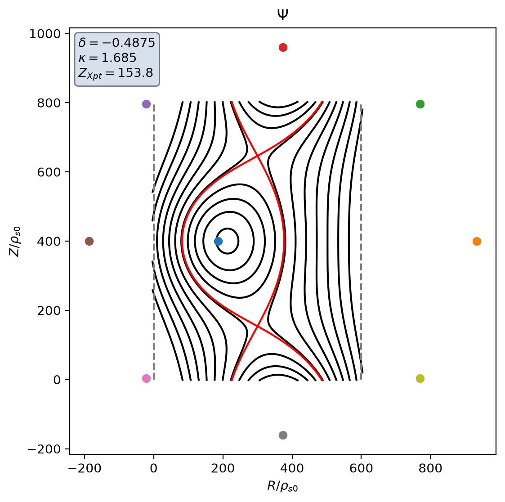
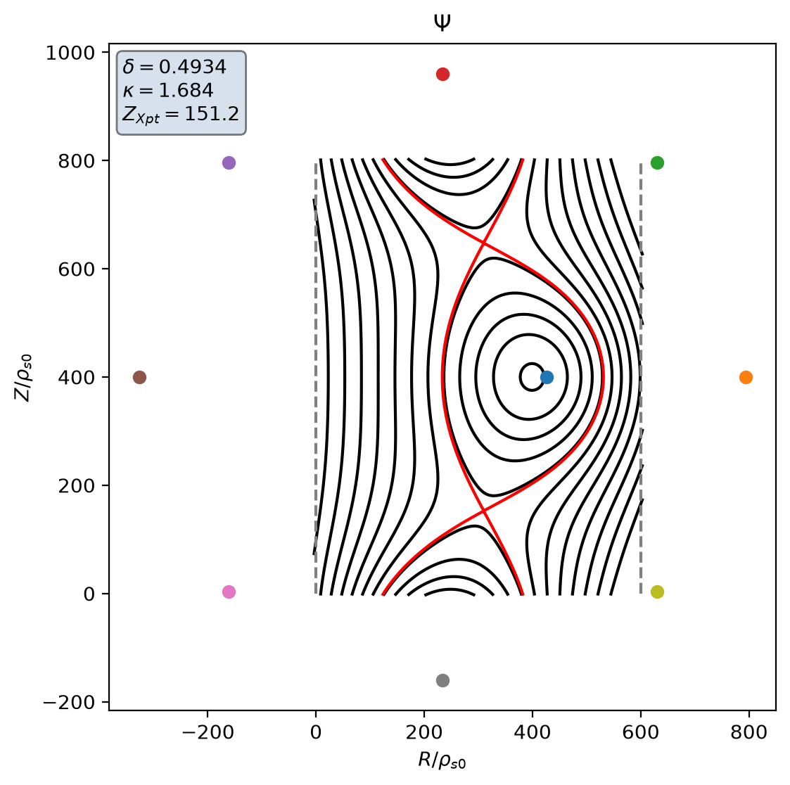
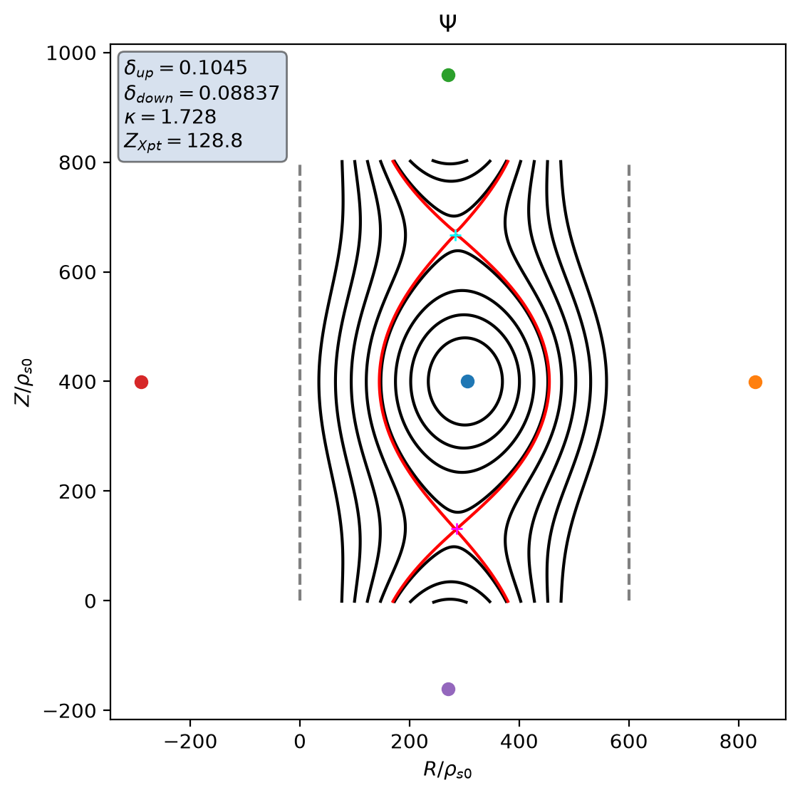
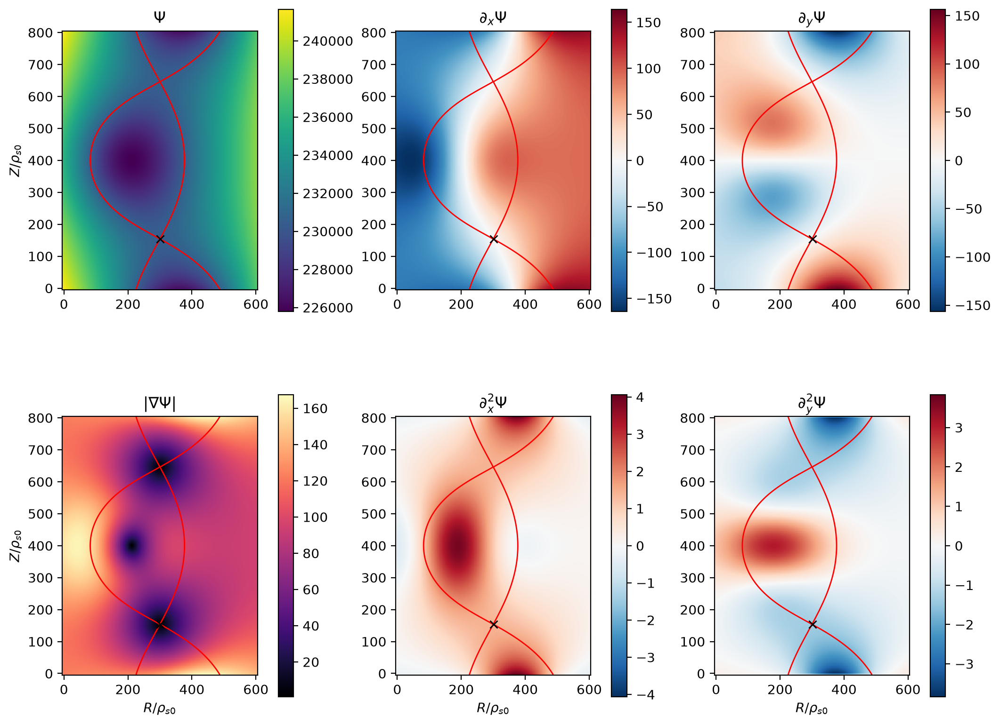

# DNtokamak

Shapes double null (DN) tokamak equilibria from line currents and export them for the GBS turbulence code.

<p align="center">
  
  
  
</p>

GBS (Global Braginskii Solver), developed at the Swiss Plasma Center, simulates plasma turbulence in the boundary of magnetic fusion devices. It needs the poloidal magnetic flux on a 2D mesh. This package builds that flux analytically from a handful of line currents and tunes the currents until the separatrix has a prescribed elongation and triangularity, with the X points at a prescribed height.

It covers two cases:

- **symmetric** double null, one triangularity `delta` (positive or negative), currents mirrored about the midplane;
- **up/down asymmetric** double null, separate `delta_up` and `delta_down`.

## Model

Lengths are in units of the reference ion sound Larmor radius `rho_s0`, as in GBS. The box is 600 by 800 with 244 by 324 mesh nodes (two guard cells on each side). The flux of a main plasma current and of `2^n` shaping currents is

$$
\Psi(R,Z) = \frac{I_0}{2}\left[ c_0 \left(\ln r_0^2 + E_1\!\left(\frac{r_0^2}{s^2}\right)\right) + \sum_{i \ge 1} c_i \ln r_i^2 \right],
\qquad r_i^2 = (R-R_i)^2 + (Z-Z_i)^2 .
$$

The main current (index 0) has a Gaussian profile of width `s`, which adds the exponential integral `E_1` and keeps the flux finite on the current. The shaping currents are filaments, placed on a circle around the plasma. Their positions and amplitudes `c_i` are the unknowns.

The **separatrix** is the flux contour through the lower X point, the minimum of the poloidal field in the lower half of the box. With `R_min` and `R_max` the radial extent of the separatrix between the X points, `R_0 = (R_min + R_max) / 2` and `a = (R_max - R_min) / 2`:

- symmetric: $\kappa = \dfrac{Z_\mathrm{up} - Z_\mathrm{low}}{R_\max - R_\min}$ and $\delta = \dfrac{R_0 - R_X}{a}$, with `R_X` the radius of the X points and `Z_low`, `Z_up` their heights;
- asymmetric: $\kappa = \dfrac{Z_\mathrm{top} - Z_\mathrm{bottom}}{R_\max - R_\min}$, $\delta_\mathrm{up} = \dfrac{R_0 - R(Z_\mathrm{top})}{a}$ and $\delta_\mathrm{down} = \dfrac{R_0 - R(Z_\mathrm{bottom})}{a}$, with the top and bottom points of the separatrix between the X points.

Positive `delta` (PT) puts the X points at a smaller radius than the radial midpoint of the plasma, negative `delta` (NT) at a larger radius.

## Generated fields

The equilibrium written for GBS holds the flux and its first and second derivatives, on the mesh nodes and on a staggered mesh. The figure shows them for the symmetric configuration with `delta = -0.5` (red: separatrix, cross: lower X point). The minima of the poloidal field magnitude are the magnetic axis and the two X points.

<p align="center">
  
</p>

HDF5 datasets, all of shape `(ny, nx)` unless noted:

- `psi_eq`: flux;
- `dpsidx_v`, `dpsidy_v`, `d2psidx2_v`, `d2psidy2_v`: derivatives on the mesh nodes;
- `dpsidx_n`, `dpsidy_n`, `d2psidx2_n`, `d2psidy2_n`: the same on the staggered mesh (omitted with `--no-staggered`);
- `xmag1`, `y0_source`: position of the main current, shape `(1, 1)`;
- `Yxpt_low`, `Yxpt_up`: heights of the lower and upper X points, shape `(1, 1)`.

Derivatives are finite differences per mesh index, they are not divided by the mesh spacing.

## Installation

Python 3.9 or later.

```bash
git clone https://github.com/Lgtlebrun/SPC.git
cd SPC
pip install -e ".[plot]"
```

The core needs numpy, scipy, contourpy and h5py. Matplotlib is only used for plots (`plot` extra).

## Usage

```bash
# plot a shipped configuration, or the exported fields with --fields
dnshape plot configs/symmetric/delta_-0.5_kappa_1.7.json --out figure.png
dnshape plot configs/symmetric/delta_-0.5_kappa_1.7.json --fields --out fields.png

# write the GBS file of a shipped configuration
dnshape export configs/symmetric/delta_-0.5_kappa_1.7.json --out results/gbs

# fit a new symmetric equilibrium, X point height between 125 and 155
dnshape symmetric --kappa 1.7 --delta -0.5 -0.4 --xpoint 125 155 --gbs --plot

# fit an up/down asymmetric equilibrium from a given start
dnshape updown --kappa 1.8 --delta-up 0.05 --delta-down 0.03 --xpoint 120 185 \
    --start configs/up_down/start_kappa_1.8.json
```

A symmetric fit takes a minute or two per triangularity on a laptop. Results go to `results/` (ignored by git). Add `-v` for debug output.

The same pieces are available from Python:

```python
from dnshape import Equilibrium, Grid, load_config, measure
from dnshape.optimize import symmetric

config = load_config("configs/symmetric/delta_-0.5_kappa_1.7.json")
eq = Equilibrium.for_kind(config.currents, config.grid, config.kind)
print(measure(eq, config.kind))

grid = Grid()
start = symmetric.match_xpoint_bounds(
    symmetric.initial_currents(grid), grid, (125, 155)
)
result = symmetric.fit(start, grid, kappa=1.7, delta=-0.5, xpoint_bounds=(125, 155))
final = symmetric.center_legs(result.currents, grid)
```

## Method

**Symmetric fit** (`optimize/symmetric.py`). The shaping currents are mirrored about the midplane, so only the main current position and half of the amplitudes are free.

1. Start from a main current and eight shaping currents on a circle, the top and bottom ones large, and adjust amplitudes one by one until the X point height lies in the requested window.
2. Run one Nelder Mead fit over all free parameters.
3. If the targets are missed, iterate rounds of a 1D fit of the main current position followed by 1D fits of each amplitude. After every step the quantity furthest from its target (delta or kappa) is the one corrected. The tolerance grows every 20 rounds, and the best configuration seen is kept.
4. Shift all currents radially to keep the separatrix legs away from the side walls.

**Asymmetric fit** (`optimize/up_down.py`), two stages by default:

1. `fit_kappa`: fit the elongation by varying one amplitude at a time.
2. `fit_triangularity`: Nelder Mead over the main current position and all amplitudes to reach `delta_up` and `delta_down`. The elongation is not constrained in this stage, so it can drift.

`fit_global` (`--method global`) is an earlier strategy of Albin Vernhes: one Nelder Mead run over every coordinate of every current, with the elongation in the cost.

All fits are local searches. Check the `shape` stored in the saved configuration against the targets.

## Shipped configurations

`configs/` holds the equilibria of the original study as JSON. Currents are stored with full float precision, so a file reproduces its flux exactly.

- `configs/symmetric/`: `delta` = ±0.3, ±0.4, ±0.5 with a target `kappa` of 1.7 and X point window 125 to 155. They were fitted, then shifted radially (`x_shift` in the file) before export.
- `configs/up_down/`: four fitted configurations and two starting points of the second stage (elongation fitted to 1.7 and to 1.8, window 120 to 185).

Fields of a JSON file: `kind` (`symmetric` or `up_down`), `grid`, `currents` (`x`, `y`, `amp`, index 0 is the plasma current), then free metadata: `description`, `targets`, `xpoint_bounds` and the measured `shape`.

## Repository layout

```
src/dnshape/
    grid.py            box, mesh, staggered mesh and scales
    currents.py        immutable Currents, ring of shaping currents
    flux.py            flux and finite difference derivatives
    equilibrium.py     cached flux, X point and separatrix of a configuration
    shape.py           kappa and delta definitions
    optimize/          symmetric.py and up_down.py
    gbs_export.py      HDF5 writer
    configs.py         JSON input and output
    plotting.py        figures (needs matplotlib)
    cli.py             the dnshape command
configs/               shipped configurations
docs/images/           figures of this page
tests/                 pytest suite
```

## Development

```bash
pip install -e ".[dev]"
pytest
ruff check . && ruff format --check .
```

The tests cover the mesh, the current geometry, the flux symmetry, the shape of every shipped configuration, the HDF5 content, short fits on a coarse mesh and the command line.

## Notes

- The up/down GBS export is not provided: `Yxpt_up` assumes up/down symmetry.
- The separatrix is extracted with contourpy directly. The original scripts went through matplotlib contour objects, whose path handling changed in matplotlib 3.8 and silently changed what the original up/down shape evaluation computes. This package does not depend on the matplotlib version. It reproduces the original scripts (run with matplotlib 3.7) bit for bit: flux, X points, shapes, HDF5 files, every objective evaluation of the fits, and the result of a full symmetric fit.

## Citation

If you use this code, please cite the paper it was written for.

Lim K, Ricci P, Lebrun L. Effect of negative triangularity on scrape-off layer plasma turbulence in double-null L-mode plasmas. Journal of Plasma Physics. 2026;92(1):E2. doi:10.1017/S0022377825101049 

## Acknowledgements

Albin Vernhes, for the global optimisation strategy (`fit_global`). The GBS team at the Swiss Plasma Center.
